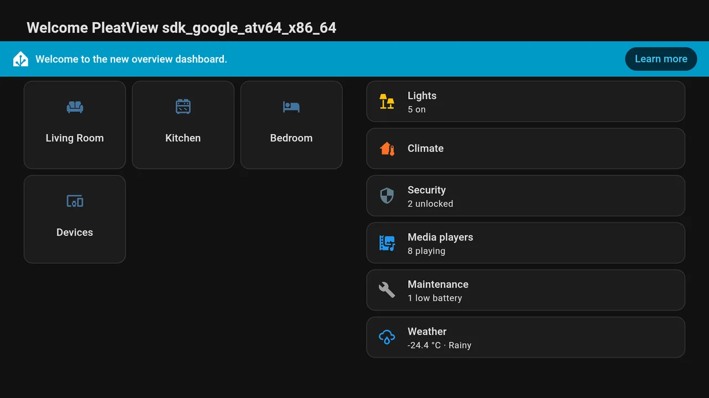

<h1 align="center">
  <picture>
    <source media="(prefers-color-scheme: dark)" srcset="brand/pleatview-logo-on-dark.svg">
    <source media="(prefers-color-scheme: light)" srcset="brand/pleatview-logo-on-light.svg">
    
  </picture>
</h1>

A lightweight Google TV / Android TV app plus a Home Assistant integration that turns
a TV into an always-on Home Assistant display you can cast to.

**Website:** [pleatview.hustlesman.com](https://pleatview.hustlesman.com) ·
**Status:** beta, see the [roadmap](ROADMAP.md) for validation and store releases.



- **Dashboards, continuously.** Any Home Assistant dashboard full screen, signed in
  automatically, without the sidebar and header, kept running for days. It recovers
  from network loss, Home Assistant restarts and WebView crashes on its own.
- **Casting from Home Assistant.** The TV is a `media_player`: play media from the media
  browser, camera streams, TTS announcements, internet radio, images and web pages.
  Video can play full screen or as picture-in-picture over the dashboard.
- **Notifications.** `notify.send_message` shows a card on the TV, optionally with a
  camera snapshot, even over other apps when allowed.
- **Small.** The release APK is about 1.2 MB, with no Google Play services and no
  cloud. Everything stays on your LAN.

```
                 control: HTTP + Server-Sent Events (port 8765, paired with a PIN)
 Home Assistant ───────────────────────────────────────────────▶  PleatView on the TV
 + pleatview      ◀───────────────────────────────────────────────  ├─ dashboard WebView
   integration      dashboards & media: the TV loads them from HA   ├─ ExoPlayer (video/audio/cameras)
                                                                    └─ notifications, standby, menu
```

## Install

Three steps, and no computer needed for the TV.

### 1. TV app

On the TV, install the free **Downloader** app (from Google Play on Google TV, or the
Amazon Appstore on Fire TV). Open it, enter **`pleatview.hustlesman.com/apk`** and
choose *Install*. Android asks once to allow installs from Downloader.

The link always serves the newest signed release from
[GitHub Releases](https://github.com/FleRoYs/pleatview/releases). Google Play and Amazon
Appstore listings are on the [roadmap](ROADMAP.md). Android 7.0 or newer; so far it has
been tested on an Android TV 16 emulator, and real devices are next.

<details>
<summary>Install with adb instead, and allow overlays</summary>

On Google TV, enable *Settings → System → About → Android TV OS build* (press 7 times),
then *Developer options → USB/Wireless debugging*:

```bash
adb connect <tv-ip>:5555     # Google TV 12+: use "adb pair" from Wireless debugging first
adb install -r pleatview.apk
```

**Recommended:** allow PleatView to display over other apps. If your TV has the setting,
use **Allow display over other apps** in PleatView's menu (press Back on the home
dashboard). Most Google TV devices don't have it, so grant it with adb instead:

```bash
adb shell appops set com.hustlesman.pleatview SYSTEM_ALERT_WINDOW allow
```

This lets Home Assistant bring PleatView to the front (Android blocks background starts
otherwise), show notifications over other apps, and open PleatView at boot.

</details>

### 2. Home Assistant integration

[](https://my.home-assistant.io/redirect/hacs_repository/?owner=FleRoYs&repository=pleatview&category=integration)

The button opens PleatView in HACS on your own Home Assistant. Install it, then restart
Home Assistant. Without HACS, copy `custom_components/pleatview` into your
`config/custom_components/` folder. Requires Home Assistant 2025.1 or newer; tested with
2026.10.

### 3. Pair

Open PleatView on the TV; it shows a 6-digit PIN. Home Assistant discovers the TV under
**Settings → Devices & services**: select **Add** and enter the PIN. A few seconds later
the TV shows your default dashboard.

If the TV isn't discovered (for example, mDNS is blocked between VLANs), use this button
and enter the address shown on the TV:

[](https://my.home-assistant.io/redirect/config_flow_start/?domain=pleatview)

Pairing creates a dedicated, local-only Home Assistant user for the TV, so nobody types
a password with the remote. Removing the integration deletes that user again. If the
TV's app data is cleared, Home Assistant asks for the new PIN and restores everything.

<details>
<summary>Other sign-in options</summary>

Open the PleatView integration in Home Assistant and choose **Reconfigure** from its ⋮
menu. You can switch to a read-only user, a long-lived access token you created, or
signing in on the TV with the remote.

Without the integration, open `http://<tv-ip>:8765` on a phone, enter the PIN, and fill
in the Home Assistant URL and a long-lived access token. Dashboards work this way;
casting and notifications need the integration.

</details>

## Using it from Home Assistant

You get `media_player.<tv>` and `notify.<tv>`. The media player is `off` while PleatView
is in the background or in standby, `idle` while showing a dashboard, and
`playing`/`paused` while showing media. Its **sources are your dashboards**.

**Webpage dashboards** (Grafana, OpenSearch, Kibana, UniFi…) work too: add one in Home
Assistant (*Settings → Dashboards → Add dashboard → Webpage*) and it becomes a source. The
TV opens the site itself rather than inside Home Assistant's frame, so sites that refuse
frames or need their own sign-in cookie still load, and the zoom applies to them as well.

| To… | Use |
| --- | --- |
| Switch dashboards | `media_player.select_source`, `pleatview.show_dashboard` (optional `duration` to return home), or the *Dashboards* folder in the media browser |
| Cast media | Media panel → choose the TV, or `media_player.play_media` |
| Show a camera | `pleatview.show_camera`: live HLS stream, MJPEG fallback, picture-in-picture by default |
| Speak | `tts.speak` with the TV as `media_player_entity_id`: plays over whatever is on, ducking it |
| Notify | `notify.send_message`, or `pleatview.notify` for image, camera snapshot, position and duration |
| Open a web page | `pleatview.show_url` (full screen or picture-in-picture) |
| Blank the screen | `media_player.turn_off` / `turn_on` (lets the TV's own sleep timer take over) |
| Reset | `pleatview.home` (stop media, close overlays, go home), `pleatview.reload` |

`media_player.play_media` accepts `extra` keys: `mode` (`fullscreen`, `pip`,
`background`), `position`, `size` (picture-in-picture width in %), `duration`, `title`,
`artist`, `image_url`, `loop`, `volume`, `start_position`. Use content type `dashboard`
with a path, or `web` with a URL, to switch dashboards or open pages.

### Examples

Doorbell pop-up over whatever the dashboard shows:

```yaml
automation:
  - alias: Doorbell on the TV
    triggers:
      - trigger: state
        entity_id: binary_sensor.doorbell
        to: "on"
    actions:
      - action: pleatview.show_camera
        target:
          entity_id: media_player.living_room_tv
        data:
          camera: camera.front_door
          position: bottom-right
          size: 35
          duration: 60
      - action: pleatview.notify
        target:
          entity_id: media_player.living_room_tv
        data:
          title: Front door
          message: Someone is at the door
          camera: camera.front_door
```

Show the energy dashboard for five minutes, then return home:

```yaml
action: pleatview.show_dashboard
target:
  entity_id: media_player.living_room_tv
data:
  path: /energy
  duration: 300
```

Loop a video in a corner:

```yaml
action: media_player.play_media
target:
  entity_id: media_player.living_room_tv
data:
  media_content_type: video
  media_content_id: media-source://media_source/local/aquarium.mp4
  extra:
    mode: pip
    position: top-right
    size: 30
    loop: true
```

PleatView also opens `pleatview://home`, `pleatview://reload` and
`pleatview://dashboard/<path>` links, so anything that can launch Android app links can
start it on a specific dashboard. That should include Home Assistant's Android TV
Remote integration (untested).

## Settings

Set these in the integration's **Configure** dialog. Home Assistant pushes them to
the TV.

| Option | Default | |
| --- | --- | --- |
| Home Assistant URL | internal URL | What the TV uses to load dashboards |
| Home dashboard | first dashboard / HA default | Path such as `/lovelace/0` |
| Dashboards | all dashboards | `Title = /path` per line. Sources, rotation, the TV menu and channel up/down |
| Kiosk mode | hide sidebar and header | Or hide only the sidebar, or off |
| Zoom | 100 % | Lower values fit more on a TV (75 % gives a 1280 px wide layout on 1080p). Applies to Webpage dashboards too |
| Rotate dashboards | off | Cycle the list while nobody uses the remote |
| Return home after idle | off | After someone browses with the remote |
| Reload every | off | Full page reload, a safety net for very long uptimes |
| Keep the screen on | on | Prevents the screensaver / ambient mode while a dashboard shows |
| Open when the TV starts | on | Needs the overlay permission |

## Remote control

- **Back** closes, in order: the menu, media, overlays, Home Assistant dialogs and
  in-page navigation. It then returns to the home dashboard, and on the
  home dashboard it opens the **menu** (address, PIN, dashboards, reload, exit).
- **Channel up/down** (or page up/down) switches between configured dashboards.
- **Play/pause, stop, fast-forward, rewind** control media while it plays.
- Any key wakes the screen from standby.

## Staying up 24/7

PleatView keeps the screen awake while a dashboard is visible, and handles failures
itself:

- Home Assistant unreachable: shows a status banner and retries with back-off (also as
  soon as the network returns).
- WebView renderer crash: recreates the WebView and reloads; the app keeps running.
- Frozen page (no heartbeat for 2 minutes) or frontend disconnected for 5 minutes:
  reloads.
- Home Assistant restarts: the frontend reconnects, and so does the integration.
- Media ends: returns to the dashboard; live streams that fall behind rejoin the edge.

The TV's own power settings (sleep timer, HDMI-CEC) still apply. Set them to never sleep
for a permanent display.

## Security

- The control API listens on port 8765 on your LAN. Only clients that know the PIN shown
  on the TV can pair. After 5 wrong PINs, pairing locks for a minute and the PIN changes.
  The TV stores only hashes of the issued tokens.
- Traffic between Home Assistant and the TV is plain HTTP on your LAN, like most local
  integrations. The token handed to the TV belongs to a dedicated *local-only* user
  (unusable from outside your network). Make that user read-only if the TV shouldn't
  control devices.
- The API never returns the token. It is excluded from Android backups and device
  transfers, and is only exposed to pages from your Home Assistant address. Web pages
  opened with `show_url` never see it.

## Development

```
android/                    Kotlin app (no Compose, no AppCompat; WebView + Media3 ExoPlayer)
custom_components/pleatview Home Assistant integration (no extra requirements)
docs/protocol.md            The HTTP/SSE API between the two
tests/                      Integration tests with a fake TV that speaks the real protocol
tools/                      Docker-based build, test and end-to-end scripts
```

```bash
tools/build-apk.sh                    # app unit tests + debug APK
tools/build-apk.sh lintDebug          # any Gradle tasks
tools/test-integration.sh             # integration tests on the pinned Home Assistant
tools/e2e/run.py                      # end to end: Android TV emulator + real Home Assistant
tools/e2e/run.py --ha-version 2025.1.4   # ...against another Home Assistant version
tools/e2e/run.py --ha-url http://192.168.1.20:8123 --ha-token-file token.txt
                                      # ...against your own (admin token; the entry is removed afterwards)
tools/e2e/run.py --device 192.168.1.30 --ha-url http://192.168.1.20:8123 --ha-token-file token.txt
                                      # ...on a real TV instead of the emulator
```

The end-to-end test needs KVM and pairs the app with a throwaway Home Assistant that
listens only on 127.0.0.1. It saves screenshots, logs and a summary with the versions
tested to `tools/e2e/out/`. With `--device` it runs the same checks on a real TV over the
network: turn on *ADB debugging* (Fire TV) or *USB debugging* (Google TV) in the TV's
developer options, and allow this computer when the TV asks. The manual
checks for real devices are in [docs/test-plan.md](docs/test-plan.md), and
[docs/stores/google-play.md](docs/stores/google-play.md) has the values for the Play Console.

The scripts only need Docker. In Android Studio, open `android/` (AGP 9.4, compileSdk 37,
JDK 17+). The debug build enables WebView debugging, so `chrome://inspect` works.

### Releases

```bash
tools/bump-version.sh 0.2.0   # app versionName/versionCode and integration version
# merge, then tag the merge commit:
git tag v0.2.0 && git push origin v0.2.0
```

The tag runs `.github/workflows/release.yml`. It signs the APK and app bundle with the
release key from the repository secrets and publishes `pleatview.apk`, the integration
zip and checksums. Keep the key safe: Android only updates an installed app signed with
the same key. For a signed local build, set `PLEATVIEW_KEYSTORE` (a path anywhere on
disk), `PLEATVIEW_KEYSTORE_PASSWORD`, `PLEATVIEW_KEY_ALIAS` and `PLEATVIEW_KEY_PASSWORD`
before running `tools/build-apk.sh assembleRelease`. Without them, release builds fall
back to the local debug key.

## Limitations

- Android-based TVs only (Google TV, Android TV, Fire TV). LG webOS and Samsung Tizen
  would need a separate web client.
- Without the overlay permission, Home Assistant can't bring PleatView to the front, and
  notifications only show while PleatView is open.
- `turn_on` can't reliably wake a TV that is fully asleep. Wake the panel with HDMI-CEC
  or the Android TV Remote integration first.
- Picture-in-picture video shows only inside PleatView, not over other apps.
- Kiosk mode styles Home Assistant's frontend from the outside, so frontend releases can
  break it. It covers the 2026 layout and the older Material drawer.
- Self-signed HTTPS certificates are rejected. Use the internal `http://` URL or a
  trusted certificate.

## Support

Help, common questions and contact details are on the
[support page](https://pleatview.hustlesman.com/support.html). Report security problems
privately as described in [SECURITY.md](SECURITY.md).

PleatView is free and open source, and every feature stays free for everyone. If it's
useful to you, you can [chip in](https://donate.stripe.com/cNifZg4Wudug46O4X38Ra00) towards test devices and app-store fees
(payments go through Stripe and appear as Hustlesman). Bug reports and ideas help just as
much.

## License

[MIT](LICENSE). PleatView is not affiliated with Home Assistant, Nabu Casa, Google,
Amazon, LG or Samsung; their names are used only to describe compatibility.
